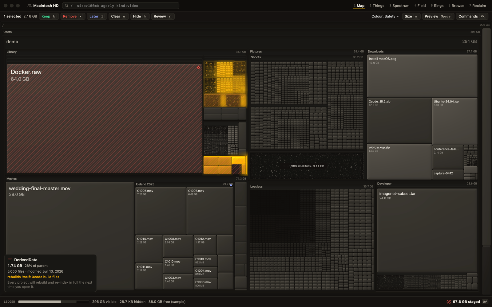
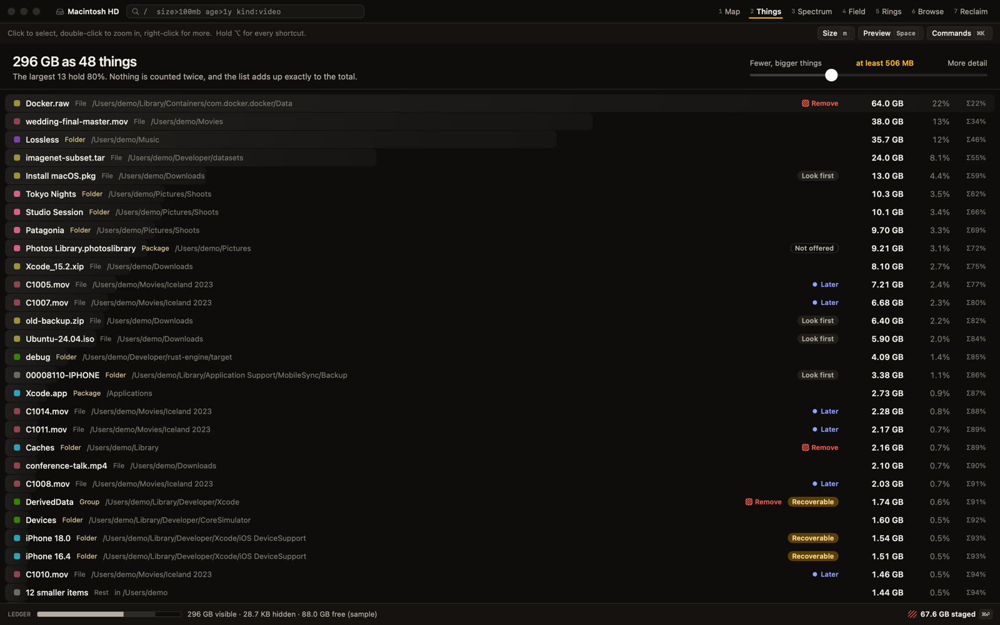
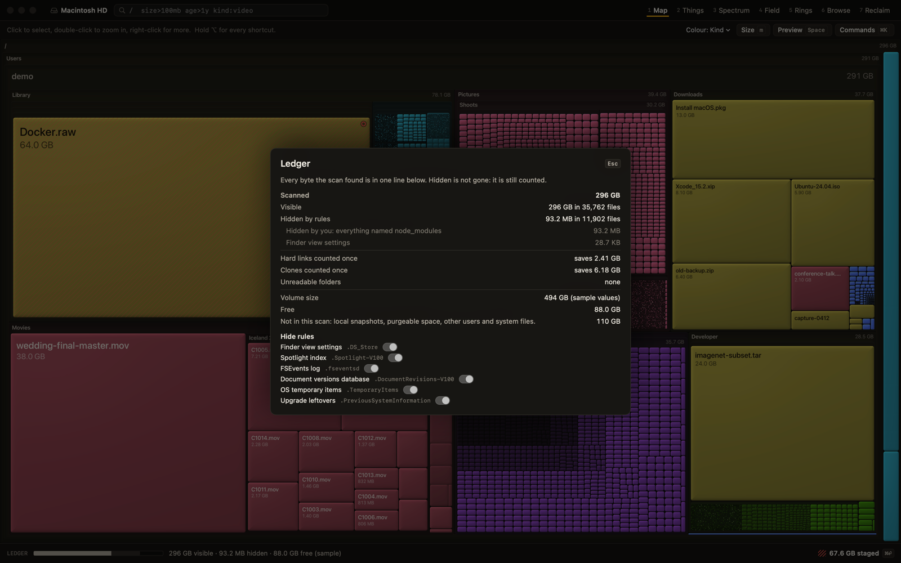
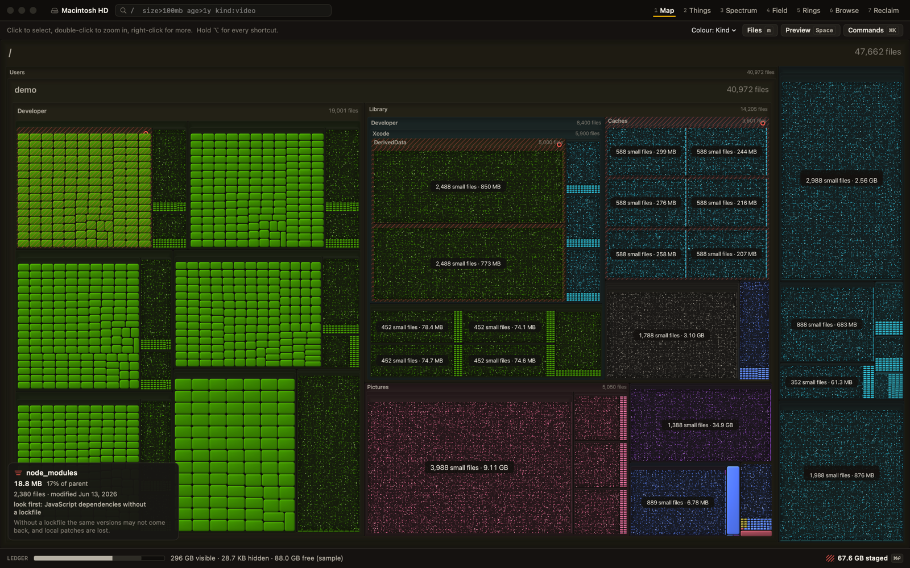
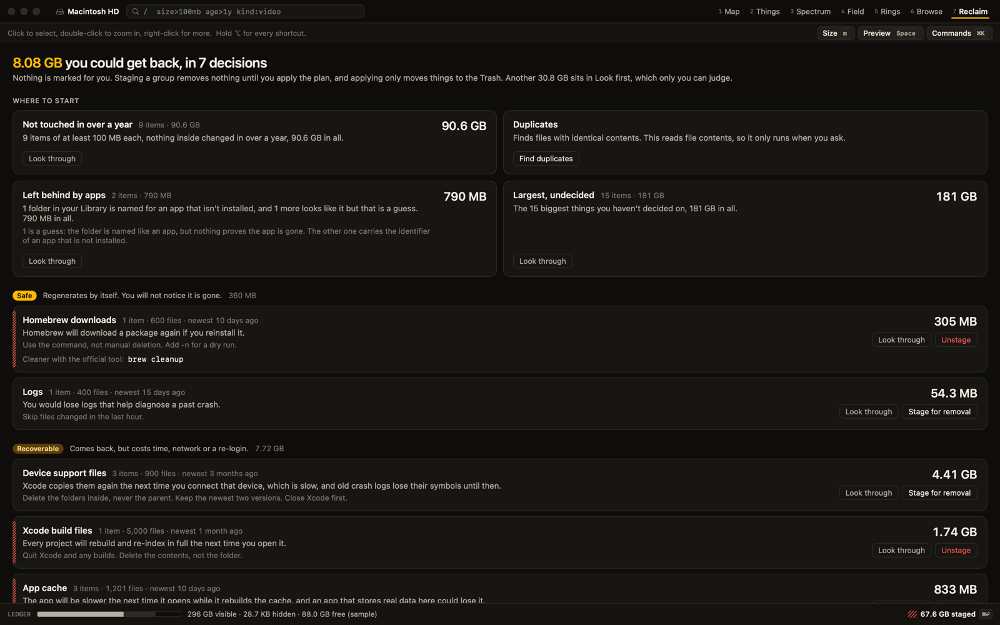
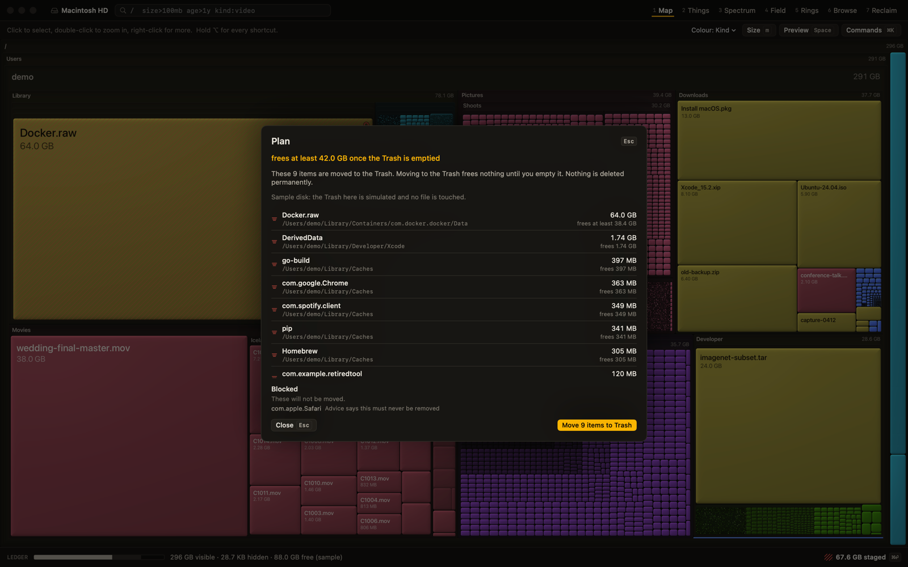
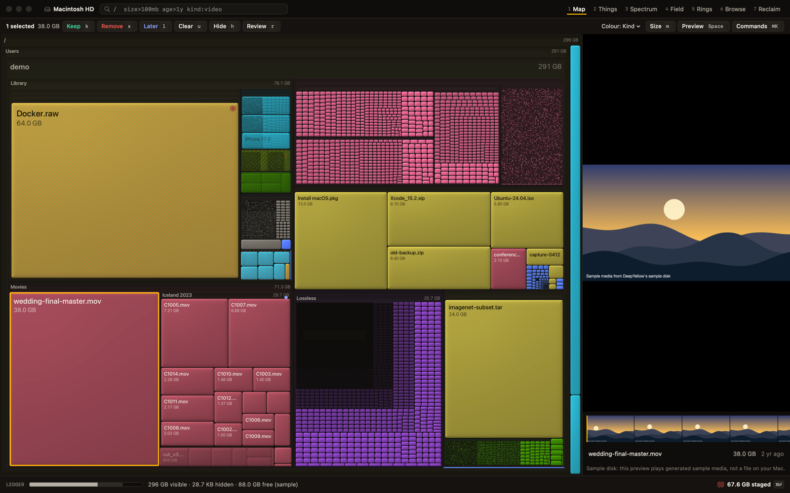
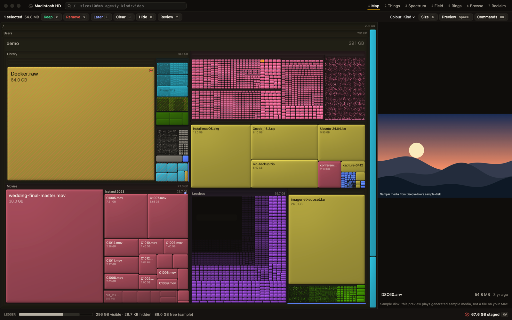

# DeepYellow

[](https://github.com/midhunkrishna/deepyellow/releases/latest)
[](LICENSE)


**See what's on your disk. Understand it at the right level of detail. Clear it without fear.**

DeepYellow is a native macOS disk analyzer. It draws your disk as a treemap you can zoom from the whole volume down to a single file, then tells you, in plain words, what each place is and what removing it would cost. Deep yellow is used for exactly one meaning: **space you could get back.**



*The built-in demo disk in Safety mode. Every screenshot here is the real app on made-up data.*

[**Download for macOS**](https://github.com/midhunkrishna/deepyellow/releases/latest/download/DeepYellow.dmg) &middot; [Releases](https://github.com/midhunkrishna/deepyellow/releases) &middot; [Documentation](docs/README.md) &middot; [If macOS blocks it](docs/install.md#if-macos-blocks-it)

## Why it's different

**Files and folders in one ranked list.** A 400 MB file and a 410 MB folder should sit next to each other. Trees make you pick a depth and flat lists make you pick files. *Things* cuts the disk at a size you choose with a slider, never double counts, and adds up exactly to the total. [How views work](docs/views.md#things)



**Every byte accounted for.** The Ledger is one bar for the whole volume: visible, hidden, unreadable, free. Hiding something removes it from the views and never from the accounting, and the reconciliation explains why the total differs from Finder. [Safety and accounting](docs/safety-and-accounting.md#the-ledger)



**Small files are never dropped.** Tiles too small to see merge into a stippled dust tile labelled with its count and size, and zooming into dust keeps going. Switch the metric from bytes to file count and swarms become giants.



**Safety advice you can read.** Each item has a tier (safe, rebuild, review, never offered) with its consequence in a sentence, the condition to meet first, and the official cleanup command where one exists. When the evidence is thin it says "review", and for most personal files it says nothing, because the honest answer is that it cannot know. [All 56 built-in rules](docs/reclaim-rules.md)



**Apply is a diff, not a dialog.** Mark things the way you would cull photos, with single keys and a Review mode that works through a set with a preview. Nothing is pre-marked. The Plan lists exactly what moves to the Trash, what is protected, and what is blocked. One step undoes it. [The Plan](docs/safety-and-accounting.md#the-plan)



**Preview before you decide.** Press Space in any view and a pane opens beside it: video with a filmstrip, images at screen size, audio, PDFs and text. Reading never changes a file.





**No AI, on purpose.** Advice comes from a written rule table and measured facts: size, age, kind, which app owns a folder, exact duplicates. You decide. On one 188 GB home folder (2.18 million files), the rules and file signatures brought unknown bytes from 45% down to 12%. About 65% of the bytes there still have no safety advice, which only the owner can judge, and the factual worklists cover 68 GB of that. That is one folder, not a promise about yours.

**Try it on your real disk with zero risk.** `deepyellow ~ --read-only` does a real scan in which nothing can be moved to the Trash. [Details](docs/cli.md#open-the-app)

**Fast.** On a 4.86 million node tree, the Things cut takes under 3 ms and queries 23 to 42 ms. Map zoom runs at about 200 fps (estimated at p95, M4, offscreen). A scan of a home folder with 2.18 million files ran at about 150,000 files per second while the machine was under load. Your numbers will differ.

**Also in your terminal.** `deepyellow things`, `reclaim`, `spectrum` and `dupes` print ranked results with colour bars, or JSON for scripts. The command line is read-only and has no delete command, by design. [Command line](docs/cli.md)

## What it will never do

- No network code, no telemetry, no analytics.
- In `--read-only` mode, cannot move anything at all.
- Never permanently deletes. Apply moves to the Trash, and DeepYellow never empties it.
- Your home folder, system folders, Photos libraries and anything in the `never` tier cannot be planned for removal, whatever you select.
- Never downloads an iCloud placeholder to look at it.

## Install

Pick how much you want to trust.

1. **Download.** Get [`DeepYellow.dmg`](https://github.com/midhunkrishna/deepyellow/releases/latest/download/DeepYellow.dmg), drag it to Applications, and check it against `SHA256SUMS`.
2. **One command.** It verifies the checksum, installs to `~/Applications` and links the CLI. Read it first, or pass `--dry-run`.

   ```
   curl -fsSL https://raw.githubusercontent.com/midhunkrishna/deepyellow/master/scripts/install.sh | sh
   ```

3. **Build it yourself.** Anyone can. You need the Swift 6 toolchain and nothing else, and no trust in a binary.

   ```
   git clone https://github.com/midhunkrishna/deepyellow && cd deepyellow && make app
   ```

macOS 15 or later, Apple silicon and Intel.

**The release build is not notarized**, because notarization needs a paid Apple developer account. macOS will ask you to approve it once: open System Settings > Privacy & Security > Open Anyway. Since macOS 15, Control-click no longer bypasses this. Full steps, the `xattr` alternative and what it does: [If macOS blocks it](docs/install.md#if-macos-blocks-it).

A complete scan needs **Full Disk Access**. Without it, DeepYellow still works, and counts and shows the folders it could not read instead of leaving them out silently. [Steps](docs/install.md#full-disk-access)

## Documentation

Everything else is in [docs/](docs/README.md): [getting started](docs/getting-started.md), [views](docs/views.md), [query language](docs/query-language.md), [safety and accounting](docs/safety-and-accounting.md), [reclaim rules](docs/reclaim-rules.md), [command line](docs/cli.md), [building from source](docs/building-from-source.md), [architecture](docs/architecture.md), [FAQ](docs/faq.md) and [uninstall](docs/uninstall.md).

## Licence

MIT, Midhun Krishna. See [LICENSE](LICENSE).
