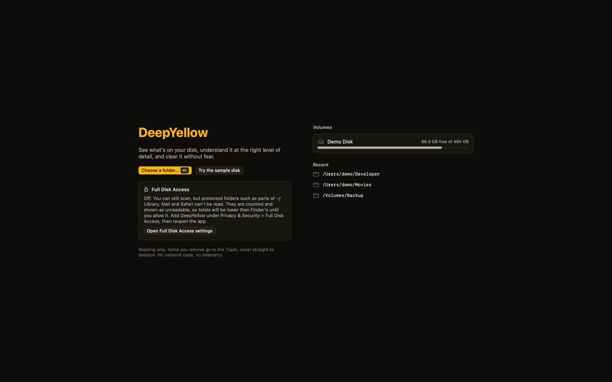

# Getting started

From download to your first reclaimed gigabytes. About five minutes, most of it the scan.

## 1. Install and open

Download `DeepYellow.dmg` from the [latest release](https://github.com/midhunkrishna/deepyellow/releases/latest), drag DeepYellow to Applications and open it. The build is not notarized, so the first launch is blocked until you approve it once; the steps are in [If macOS blocks it](install.md#if-macos-blocks-it). Other routes are in [Install](install.md).

DeepYellow needs macOS 15 or later.

## 2. Give it Full Disk Access (recommended)

Without Full Disk Access macOS hides parts of your disk from every app. DeepYellow says so up front and counts what it could not read, but a complete scan needs the permission.

1. Open **System Settings > Privacy & Security > Full Disk Access**.
2. Switch **DeepYellow** on. If it is not listed, click **+** and add it from Applications.
3. Quit and reopen DeepYellow.

You can skip this and scan a single folder instead. See [Full Disk Access](safety-and-accounting.md#full-disk-access).



## 3. Scan

Choose a volume or a folder on the welcome screen, or drop a folder onto the Dock icon. The map grows while the scan runs and is interactive from the first second. You can also try everything on a built-in sample disk:

```
deepyellow --demo
```

### Want to look at your real disk with zero risk?

Open it in read-only mode:

```
deepyellow ~ --read-only
```

That does a real scan, so the sizes, the map and the advice are real, but **nothing can be moved to the Trash** in that mode. It is the natural way to get to know the app before you trust it with a Plan. (Link the `deepyellow` command first, see [Install](install.md#install-the-command-line-tool).) More in [Command line](cli.md).

## 4. Find the gold

The [Map](views.md#map) is the main view. Press <kbd>c</kbd> until the colour mode is **Safety**: everything dims except what is safe or rebuildable, which glows gold.


Then press <kbd>7</kbd> for [Reclaim](views.md#reclaim). Items are grouped by tier, and each shows what it is, what removing it costs, and the official cleanup command where there is one.

Not everything has advice. For most personal files, such as photos, documents and downloads, the honest answer is "no advice", and the decision is yours.

## 5. Decide

Select something and press one key.

| Key | Verdict |
|---|---|
| <kbd>k</kbd> | Keep |
| <kbd>x</kbd> | Remove (staged, not done) |
| <kbd>l</kbd> | Later |
| <kbd>u</kbd> | Clear |

Nothing is pre-marked. For a long list press <kbd>r</kbd> to open [Review](views.md#review), which goes through the current set one item at a time with a preview.

## 6. Apply, then check the Trash

Press <kbd>&#8984;&#9166;</kbd> to open the **Plan**: the exact list of items that will be moved to the Trash, what is protected inside them, and what is blocked and why.


Apply moves them to the Trash and offers one-step undo. **Space is not freed until you empty the Trash.** DeepYellow never empties it for you. More in [Safety and accounting](safety-and-accounting.md).

## Next

- [Views and keys](views.md)
- [Query language](query-language.md)
- [The command line](cli.md)
