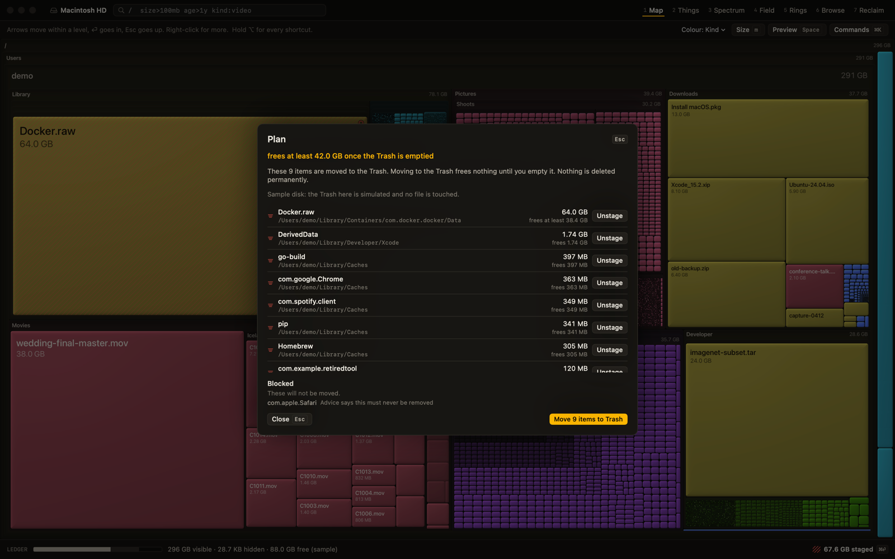
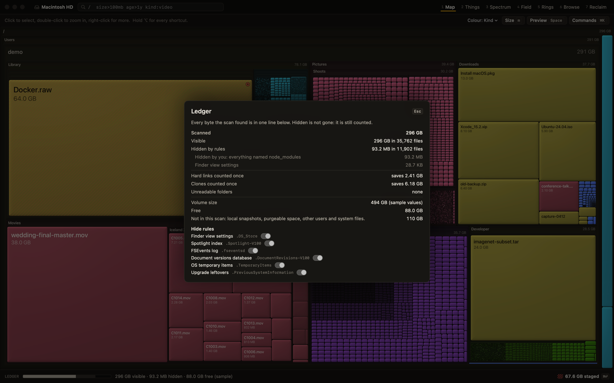

# Safety and accounting

This page covers how DeepYellow keeps you from removing the wrong thing, and how it keeps its numbers true to the disk.

## The rules it holds itself to

1. No network code, no telemetry, no analytics. Disk tools need wide access, so the app makes no network connections at all.
2. It never permanently deletes anything. Apply moves items to the Trash. And `deepyellow <path> --read-only` opens a real scan in which nothing can be moved at all.
3. The scan root, your home folder, top-level system folders and protected items can never be planned for removal, whatever you select.
4. There is no hidden selection. Everything acted on is visibly selected, with the count and bytes always on screen.
5. A scan never silently under-reports. Unreadable folders are counted and shown, and missing Full Disk Access is stated up front.
6. Reading a file never downloads it and never modifies it. iCloud placeholders stay placeholders.
7. Advice follows a documented table, and when the evidence is limited an item stays at **review**.

## Tiers

Every item carries a tier, and each tier says what the consequence is in plain words.

| Tier | Meaning | Example |
|---|---|---|
| **Safe** | Regenerates automatically with no visible loss | Logs, Homebrew downloads |
| **Rebuild** | Recoverable at a cost of time, network or a login | Xcode build files, `node_modules` next to a lockfile |
| **Review** | May hold something of yours, so you have to look | A Docker disk image, iPhone backups, downloaded installers |
| **Never offered** | Must not be planned for removal | Your Photos library, Mail data, system update areas |
| (no advice) | Nothing is known | Most documents, photos, videos and downloads |

When an item is uncertain it is review, and it is never rounded up to safe. A `never` item always wins over anything above it, and otherwise the most specific rule wins. The rules, with each one's source and consequence, are in [Reclaim rules](reclaim-rules.md).

Most of your disk will have **no advice**. DeepYellow does not use AI to guess, since the app wouldn't have that kind of intelligence. It has a rule table and facts it can measure (size, age, kind, which app owns a folder, exact duplicates), and the decision is yours. The [worklists](views.md#worklists) turn "no advice" into factual lists such as "large, and untouched for over a year". To give an idea of the scale, on one measured home folder (188 GB, 2.18 million files), about 65% of the bytes had no safety advice, and the worklists covered 68 GB of that.

## SQL is read-only

You can query your scan with [SQL](sql.md), but it can't write. `DELETE`, `UPDATE`, `INSERT`, `DROP`, `CREATE`, `ATTACH`, `DETACH`, `VACUUM INTO`, `PRAGMA` and `load_extension` are refused. A SQL result never marks anything and never reaches the Plan. Marks still come only from selection and <kbd>k</kbd> <kbd>x</kbd> <kbd>l</kbd> <kbd>u</kbd>.

## Staged decisions

Marking works like `git add`. <kbd>x</kbd> stages an item for removal and changes nothing on disk. The staged total is always on screen at the right of the Ledger.

- Nothing is ever pre-marked. Keep is the default.
- Decisions inherit downward and the deepest one wins. Keeping one file inside a folder marked remove is a normal state, shown as partial, and the folder itself is not trashed.
- Decisions persist across scans, keyed by path with a fingerprint of the size, modified time and inode. If an item changes after you judged it, the verdict is flagged stale and is **not applied**.
- <kbd>&#8984;Z</kbd> and <kbd>&#8679;&#8984;Z</kbd> undo and redo decisions.

## The Plan

<kbd>&#8984;&#9166;</kbd> opens the Plan, which is the exact diff of what Apply will do. There are no per-item "are you sure" dialogs, because they teach blind clicking. The Plan shows the following:

- **Items**: the minimal set of roots to move to the Trash, never a folder and something inside it. **Unstage** beside an item takes it out of the plan. An item staged through a marked folder is marked keep instead, so the rest of the folder stays staged.
- **Protected**: what inside those roots is being kept.
- **Blocked**: anything that cannot be removed, and the reason.
- **Estimate**: "frees at least 41.2 GB" is only said when it is true. If the app could not measure how much space an item would actually free (for example, cloned data that is shared with something you keep), it says so instead.

These are always blocked, regardless of what was selected: the scan root, `/`, your home folder and its ancestors, `/System`, `/Applications`, `/Library`, `/Users`, `/usr`, `/bin`, `/sbin`, `/private`, `/Volumes`, direct children of `/`, `~/Library` itself, `~/Documents`, `~/Desktop`, `~/Pictures`, `~/Movies`, `~/Music` and `~/Downloads` themselves (their contents can be planned), unreadable or restricted items, folders you don't have permission to change and anything directly inside one, mount boundaries, anything in tier `never`, anything inside a `.photoslibrary`, and anything whose fingerprint no longer matches.

The folders macOS keeps in `~/Library` and `/Library`, such as `Caches` and `Logs`, are never moved themselves. If you mark one, the Plan lists what is inside it instead, and the folder stays where it is.

### Apply, Trash and undo

Apply moves the roots to the Trash and re-checks each item's fingerprint immediately before moving it. If something changed, it is skipped and reported. Anything that could not be moved stays staged and is listed first in the Plan with the reason, and you can unstage those items one at a time or all together. The code that applies a plan has no path that deletes anything. **One step undoes the last apply** and puts everything back where it was.

The Trash frees nothing until it is emptied, and DeepYellow never empties it. I decided against an Empty Trash command, so that part is done in Finder when you are ready.

## The Ledger

The bar along the bottom is a single account of the whole volume, split into visible, hidden, unreadable or unaccounted, and free. Staged removal is hatched over the top.

Click it for the reconciliation, which explains why DeepYellow's numbers can differ from Finder's:

- **Logical against allocated size.** A file's size and the space it occupies differ. DeepYellow measures allocated space by default.
- **Hard links and clones.** Space shared by hard links or APFS clones is counted once.
- **Snapshots and purgeable space** that macOS reports separately.
- **A labeled remainder.** Whatever cannot be attributed is shown as such, not hidden.

### Hidden is never gone

Ignore rules remove things from views but never from the accounting. The Ledger always shows "Hidden: 18.2 GB in 41,204 files"-style totals and opens to per-rule totals.

## Full Disk Access

macOS protects parts of your disk from every app until you allow it. DeepYellow works without Full Disk Access, but a scan then cannot read some folders. It counts them, shows how many, and tells you at the start, rather than drawing them as empty.

To grant it, see [Install: Full Disk Access](install.md#full-disk-access), including the note that an update of an ad-hoc signed build may need the permission granted again.

## What the app cannot promise

- It cannot know that a file is unimportant to you. The tiers describe what the place is, not how you feel about it.
- A scan is a snapshot. Files that change after the scan are caught by the fingerprint check on Apply, but the picture on screen is not live.
- Space only returns after you empty the Trash.
