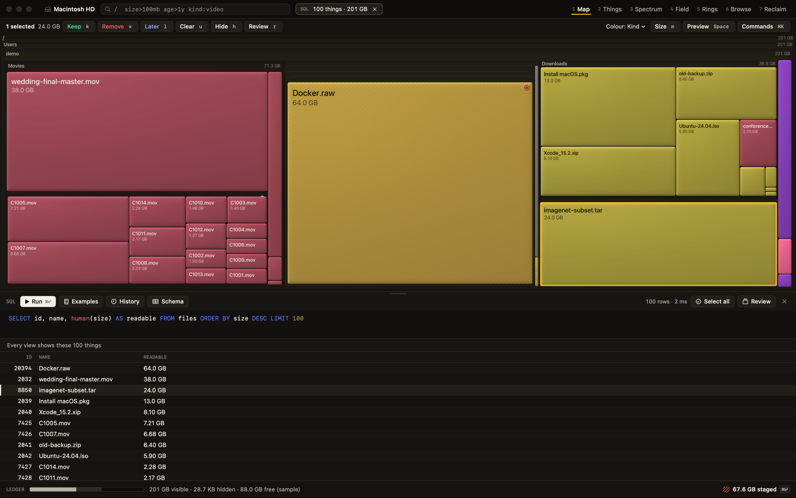
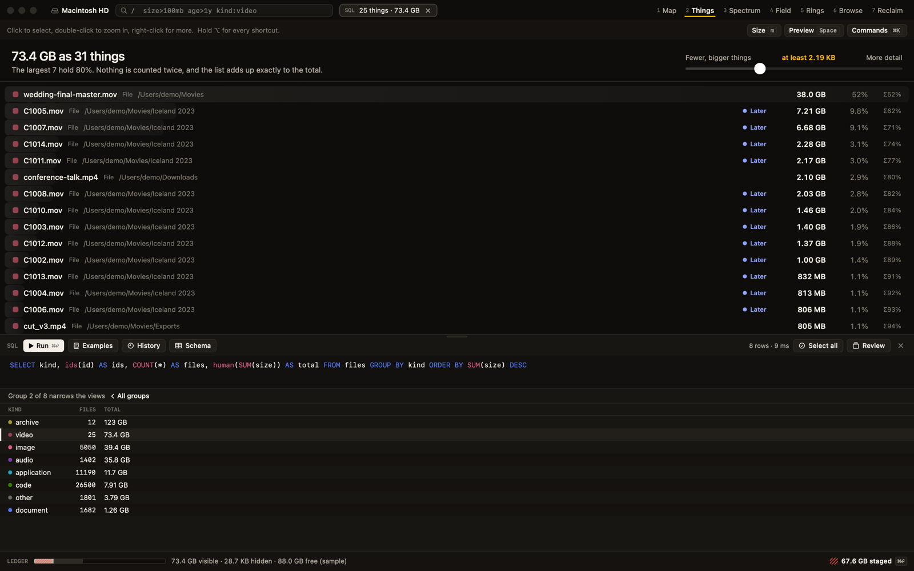
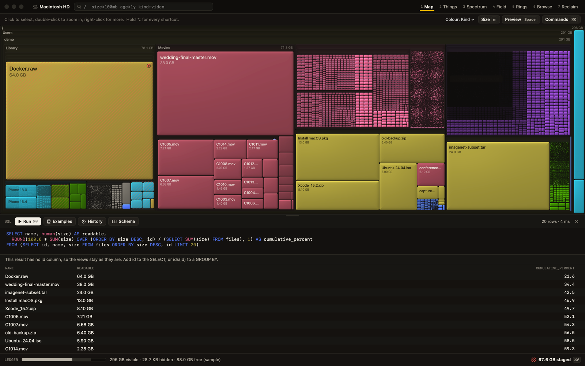

# SQL

Ask your disk a question in SQL, and the answer is not just a table. **A result becomes the set that every view shows.** Run `SELECT id FROM files ORDER BY size DESC LIMIT 20` and the Map, Things, Spectrum, Field and Rings all narrow to those 20 files. Click a row and the preview, the selection and your marks work as they do everywhere else.



## What it is, and what it is not

- It is SQLite's `SELECT` dialect: joins, subqueries, CTEs including recursive ones, window functions, aggregates, `CASE`, and the rest of what SQLite's `SELECT` supports. It is not a different or larger SQL, and it is not called "full SQL" because that would promise more than it is.
- It is **read-only**. Every statement that writes is refused (see [Refusals](#refusals)), and the app can not be made to change a file, a mark, or the Trash from SQL.
- It runs on the scan you have already made. The tree is not copied into a database: the `nodes` table reads the scan directly.
- It is available once the scan has finished. Before that, running a query says "SQL is available when the scan finishes."
- It uses no AI. You write the question.

SQL never marks or removes anything. **Marks still go through selection and the keys <kbd>k</kbd> <kbd>x</kbd> <kbd>l</kbd> <kbd>u</kbd>**, and removal still goes through the [Plan](safety-and-accounting.md#the-plan). SQL can find the files; you decide.

## Open it

Press <kbd>s</kbd>, or choose View > SQL, or use the palette. SQL is a drawer that docks at the bottom, not an eighth view, so the view above keeps responding while you type. Drag its top edge to resize it.

- <kbd>&#8984;&#9166;</kbd> runs the query while the editor has focus. Outside the editor, <kbd>&#8984;&#9166;</kbd> still opens the Plan.
- Single-key shortcuts do not fire while you type. <kbd>Esc</kbd> leaves the editor.
- The toolbar has Run, Cancel while a query is running, an **Examples** menu, a **History** menu (the last 20 queries, newest first), a **Schema** popover listing every column and function, and the elapsed time.
- For results that drive the views there are two more buttons: **Select all** selects every node of the set, and **Review** opens [Review](views.md#review) over it.
- While a result narrows the views, a chip beside the query field shows what is left, for example `SQL 12 things · 184 GB`. Its **x** clears the filter. The query text and the history stay.

## How a result drives the views

What the result contains decides what happens.

| Your `SELECT` has | The result is | What the views do |
|---|---|---|
| A column named exactly `id` | A set of nodes | Every view shows just those nodes |
| A `GROUP BY` and a column `ids(id) AS ids` | Groups | Every view shows all the groups together. **Click a group row** to narrow to that group, and click "All groups" to go back |
| Neither | A table only | The views stay as they are, and any earlier SQL filter is cleared. The drawer says: "This result has no id column, so the views stay as they are. Add id to the SELECT, or ids(id) to a GROUP BY." |

Rules that apply to sets and groups:

- **Folders bring their whole subtree.** If `id` is a folder, everything inside it is in the set. The chip counts the items the result names, as the table does, and counts each byte once even when a folder and its contents are both rows.
- **Reclaim narrows too.** Its cards show what's in the result, such as "12.6 GB in this result, of 18.0 GB". Staging a card acts on whole folders, and the Plan lists exactly what is staged.
- **Results AND with the `/` query.** If you also have a [query](query-language.md) typed in the query field, a node must satisfy both.
- **A result stays true.** When the scan, a hide rule, a decision, the Trash or a safety tier changes, the query runs again by itself, and an old result is never applied to a new scan. If you had drilled into a group, that stays only when the number of groups is unchanged.
- **The Ledger still reconciles.** Hidden space stays accounted for. What a SQL result filters out is counted as filtered, as with the query.
- Ids that are not in the tree are ignored, not errors.



A result that is only a table is still useful:



The table shows up to 5,000 rows, and says, for example, "showing 5,000 of 1,204,311 rows" when there are more. The views are not limited to 5,000: they show the whole set.

## Schema

One virtual table, `nodes`, with one row per file or folder, and two views over it: **`files`** (`is_dir = 0 AND visible = 1`) and **`dirs`** (`is_dir = 1 AND visible = 1`). Use `files` and `dirs` for what the views show, and `nodes` when you want everything, including what a hide rule hides.

| Column | Type | Meaning |
|---|---|---|
| `id` | INTEGER | Node id |
| `parent` | INTEGER | Parent's id; NULL for the root |
| `name` | TEXT | File or folder name |
| `ext` | TEXT | Lower-case extension without the dot; NULL for none or for folders |
| `path` | TEXT | Full path, built only when read |
| `depth` | INTEGER | 0 for the root |
| `size` | INTEGER | Bytes on disk as the views count them |
| `logical` | INTEGER | Logical bytes |
| `file_count` | INTEGER | Files at or under the node |
| `modified` | INTEGER | Modification time, seconds since 1970 |
| `accessed` | INTEGER | Access time, seconds since 1970 (approximate) |
| `kind` | TEXT | video, image, audio, document, code, application, archive or other |
| `is_dir` | INTEGER | 1 for a folder or package, else 0 |
| `is_package` | INTEGER | 1 for a macOS package such as an .app |
| `is_symlink` | INTEGER | 1 for a symbolic link |
| `is_clone` | INTEGER | 1 for a later full clone whose bytes are counted elsewhere |
| `is_hardlink` | INTEGER | 1 for a later hard link whose bytes are counted elsewhere |
| `is_dataless` | INTEGER | 1 for an iCloud placeholder that isn't stored locally |
| `visible` | INTEGER | 1 when no ignore rule or Trash removal hides the node |
| `mark` | TEXT | keep, remove or later; NULL for none |
| `safety` | TEXT | safe, rebuild, review or never; NULL for no advice |

`visible`, `mark` and `safety` are the same values the app shows. A `NULL` safety means no advice, which is the honest answer for most personal files. `size` and `file_count` follow the current view settings, so what you sum here matches what you see on screen.

## Functions

| Function | Meaning |
|---|---|
| `kb(n)` | n kilobytes in bytes (n x 1,000) |
| `mb(n)` | n megabytes in bytes (n x 1,000,000) |
| `gb(n)` | n gigabytes in bytes (n x 1,000,000,000) |
| `tb(n)` | n terabytes in bytes (n x 1,000,000,000,000) |
| `human(bytes)` | A size as the app prints it, such as 1.2 GB |
| `age_days(seconds)` | Whole days between a timestamp and now |
| `ids(id)` | Aggregate: the ids of a group. Alias it as `ids` to let a row drive the views |

Units are decimal, the same as the [query language](query-language.md#units).

## Examples

The **Examples** menu in the drawer has these. Each one runs on the sample disk. All of them drive the views except the last, which is a table.

**Biggest files**

```sql
SELECT id, name, human(size) AS readable FROM files ORDER BY size DESC LIMIT 100
```

**Big files untouched for a year**

```sql
SELECT id, name, human(size) AS readable, age_days(modified) AS days FROM files
WHERE size > mb(100) AND age_days(modified) > 365
ORDER BY size DESC
```

**Video over 1 GB**

```sql
SELECT id, name, human(size) AS readable FROM files WHERE kind = 'video' AND size > gb(1) ORDER BY size DESC
```

**Biggest folders**

```sql
SELECT id, name, human(size) AS readable, file_count FROM dirs WHERE depth > 0 ORDER BY size DESC LIMIT 100
```

**Files in the five biggest folders**

```sql
SELECT f.id, f.name, human(f.size) AS readable FROM files f
JOIN (SELECT id FROM dirs ORDER BY size DESC LIMIT 5) d ON f.parent = d.id
ORDER BY f.size DESC
```

**Everything inside the biggest top-level folder**

```sql
WITH RECURSIVE inside(id) AS (
  SELECT id FROM (SELECT id FROM dirs WHERE depth = 1 ORDER BY size DESC LIMIT 1)
  UNION ALL
  SELECT n.id FROM nodes n JOIN inside ON n.parent = inside.id
)
SELECT n.id, n.name, human(n.size) AS readable FROM nodes n JOIN inside USING (id) WHERE n.is_dir = 0
```

**Marked for removal**

```sql
SELECT id, name, human(size) AS readable FROM nodes WHERE mark = 'remove' ORDER BY size DESC
```

**Safe or rebuildable**

```sql
SELECT id, name, safety, human(size) AS readable FROM nodes WHERE safety IN ('safe', 'rebuild') ORDER BY size DESC LIMIT 200
```

**Space by kind** (groups: click a row to narrow the views to that kind)

```sql
SELECT kind, ids(id) AS ids, COUNT(*) AS files, human(SUM(size)) AS total FROM files GROUP BY kind ORDER BY SUM(size) DESC
```

**Space by extension**

```sql
SELECT ext, ids(id) AS ids, COUNT(*) AS files, human(SUM(size)) AS total FROM files WHERE ext IS NOT NULL
GROUP BY ext ORDER BY SUM(size) DESC LIMIT 50
```

**Same name and size** (groups). This only compares names and sizes, so it finds candidates. For exact duplicates use [Duplicates](views.md#worklists), which compares contents.

```sql
SELECT name, ids(id) AS ids, COUNT(*) AS copies, human(size) AS each_size FROM files WHERE size > mb(1)
GROUP BY name, size HAVING COUNT(*) > 1 ORDER BY SUM(size) DESC
```

**Cumulative share of the 20 biggest files** (table only, because it has no `id`)

```sql
SELECT name, human(size) AS readable,
  ROUND(100.0 * SUM(size) OVER (ORDER BY size DESC, id) / (SELECT SUM(size) FROM files), 1) AS cumulative_percent
FROM (SELECT id, name, size FROM files ORDER BY size DESC, id LIMIT 20)
```

## Refusals

SQL here cannot change anything. A statement that writes is refused, and the message says why: "DeepYellow's SQL is read-only, so DELETE isn't allowed. To remove something, select it and press x."

Refused: `DELETE`, `UPDATE`, `INSERT`, `DROP`, `CREATE`, `ATTACH`, `DETACH`, `VACUUM INTO`, `PRAGMA` and `load_extension`. The tests make sixteen such attempts and check that each one is refused and that none of them creates a file.

This is enforced in several layers rather than by a text check: the table has no write path, the connection only allows reading, and a statement SQLite does not consider read-only is rejected. Each query runs on a fresh in-memory connection, with sorts kept in memory, and a query that would use more than 2 GB of memory is stopped and reported as too large. A running query can be cancelled.

## Speed

Measured in a release build on a synthetic disk of 4,856,132 items, on one machine. Your disk and Mac will differ.

| Query | Time |
|---|---|
| `SELECT kind, SUM(size), COUNT(*) FROM files GROUP BY kind` | 729 ms |
| Filter and sort, top 100 | 173 ms |
| Group by extension, with `ids` | 1,282 ms |
| Join to parent, grouped | 805 ms |
| Path of the 100 biggest | 158 ms |

## On the command line

`deepyellow sql` runs the same engine in the terminal. See [Command line](cli.md#sql).

```
deepyellow sql --demo "SELECT kind, human(SUM(size)) AS total FROM files GROUP BY kind"
```

## Which to use: query or SQL

The `/` [query](query-language.md) is the quick filter: one line, in every view, live as you type. SQL is for questions the query language can not say: joins, grouping, sums, "the five biggest folders and what is in them", or anything that needs a calculation. The two combine: a SQL result and the query both apply.
