# Views

There are seven lenses and one mode. All of them read the same scan and share one selection and one query, and each is one key away. When we switch between them, the focus and the selection stay where they were.

| Key | View | The question it answers |
|---|---|---|
| <kbd>1</kbd> | [Map](#map) | Where did it all go? |
| <kbd>2</kbd> | [Things](#things) | What are the biggest things? |
| <kbd>3</kbd> | [Spectrum](#spectrum) | What shape is my disk? |
| <kbd>4</kbd> | [Field](#field) | What is old, big and forgotten? |
| <kbd>5</kbd> | [Rings](#rings) | How is it nested? |
| <kbd>6</kbd> | [Browse](#browse) | Where is that thing I know about? |
| <kbd>7</kbd> | [Reclaim](#reclaim) | What can I remove safely? |
| <kbd>r</kbd> | [Review](#review) | Should this go? A mode, not a lens. |

The window has one thin line at the top (path, query, view tabs) and one at the bottom (the [Ledger](safety-and-accounting.md#the-ledger)). Panels appear only when you ask for them. Hold <kbd>&#8997;</kbd> to overlay every shortcut on the screen.

## Map

The Map is a treemap, where each rectangle is a file or folder sized by its bytes. It zooms continuously. Scroll or pinch to zoom around the cursor, drag to pan, double-click to zoom in and press <kbd>&#9003;</kbd> to zoom out. The layout is fixed in world space, so zooming doesn't reflow the tiles.

On the keyboard, the Map works level by level. The arrow keys move to the tile next to the selection (up, down, left or right) within the same folder. <kbd>&#9166;</kbd> goes into the selected folder and selects its first item. <kbd>Esc</kbd> goes back up and selects the folder you were in. At the top level, <kbd>Esc</kbd> clears the selection.

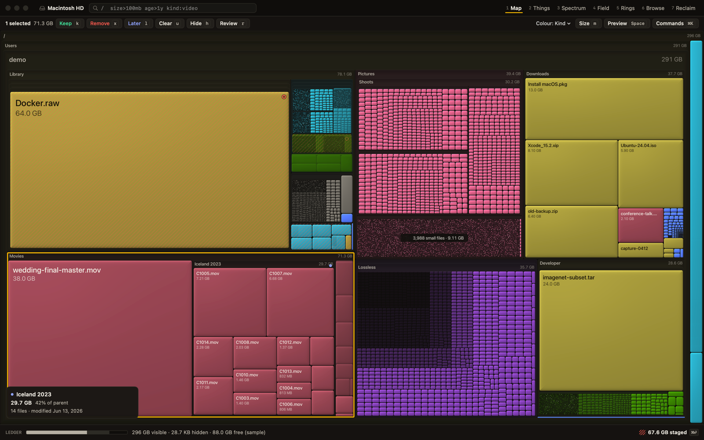

- Folders that are large enough on screen get a header with name and size, and tiles get labels when they fit.
- **Dust.** Tiles too small to see merge into one stippled tile per folder, labeled like "3,988 small files, 9.11 GB". The stipple density follows the count. Zooming into dust keeps going, and it resolves into tiles at any depth.
- **Metric.** Press <kbd>m</kbd> to switch between bytes and file count. A swarm of files that is invisible by bytes becomes a giant by count.

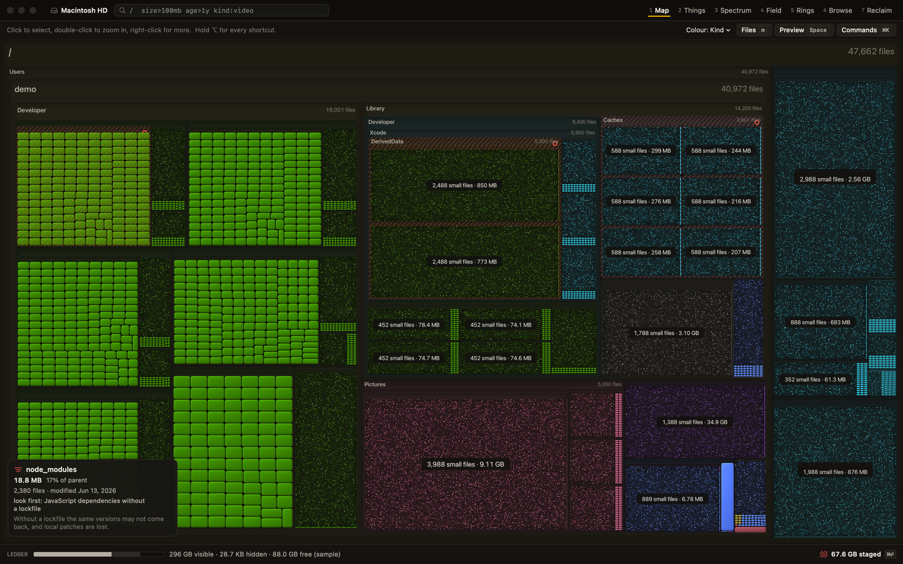

- **Hover** shows the name, size, share of the parent, last modified, file count, safety tier and why.

### Colour modes

Press <kbd>c</kbd> in Map, Rings or Field to cycle through the modes below.

| Mode | Colours mean |
|---|---|
| Kind | Video, images, audio, documents, code and data, apps and libraries, archives and disks, other |
| Age | How long since the item changed |
| Safety | Gold where it is reclaimable, everything else dimmed |
| Decision | What you marked: remove is a hatch, keep is a pin, later is a dot |

State is never shown by colour alone.

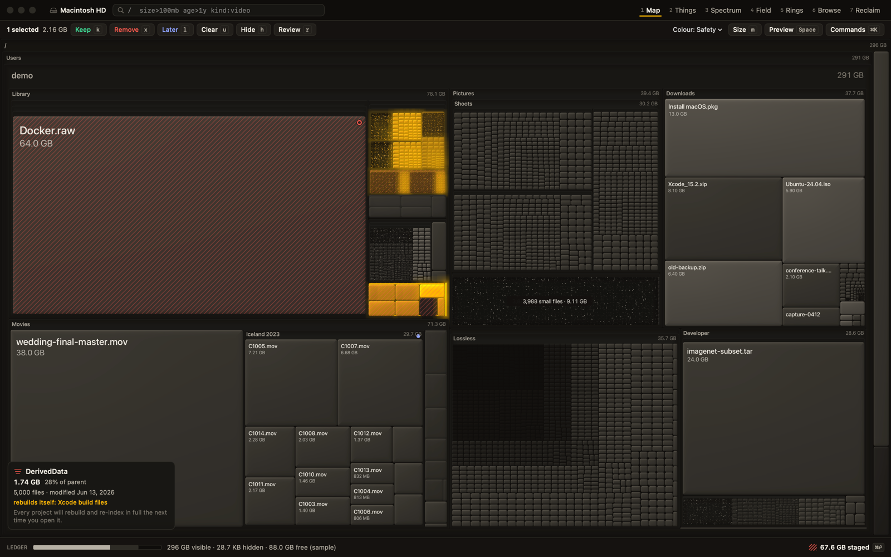

## Things

Things is a ranked list of the biggest things, where files and folders are peers. A thing is a file or folder that is at least the threshold and cannot be split into anything that big. If a folder has a big child, the folder is split and the remainder is rolled into "N smaller items in X", or carried up if it is still under the threshold. This way nothing is counted twice, and the list adds up exactly to the total.

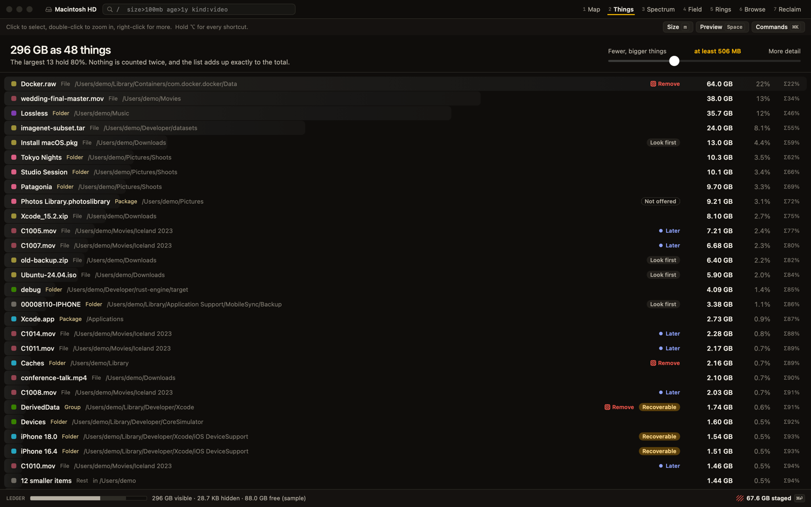

The slider sets the level of detail, from a dozen things to thousands. Say the threshold is 400 MB. A 400 MB file and a 410 MB folder then show up as neighboring rows. A cumulative-share rail shows how much of the disk the top rows hold.

Some folders are treated as **atoms**, which means they stay whole until you open them. These are apps and other packages, and folders named `node_modules`, `.git`, `DerivedData`, `.venv`, `venv`, `__pycache__`, `Pods`, `.gradle`, `.next`, `.cache` and `.pnpm-store`. The folders `target`, `dist` and `build` count as atoms only when a project file such as `Cargo.toml` or `package.json` sits beside them.

## Spectrum

Spectrum is the size histogram of your files in human ranges, with three bins per power of ten. Count and bytes are shown as two separate small multiples and never on one dual axis. A cumulative curve sits next to them, and it answers questions like "the top 40 items hold 80% of your disk". Brush a range to filter every other view.

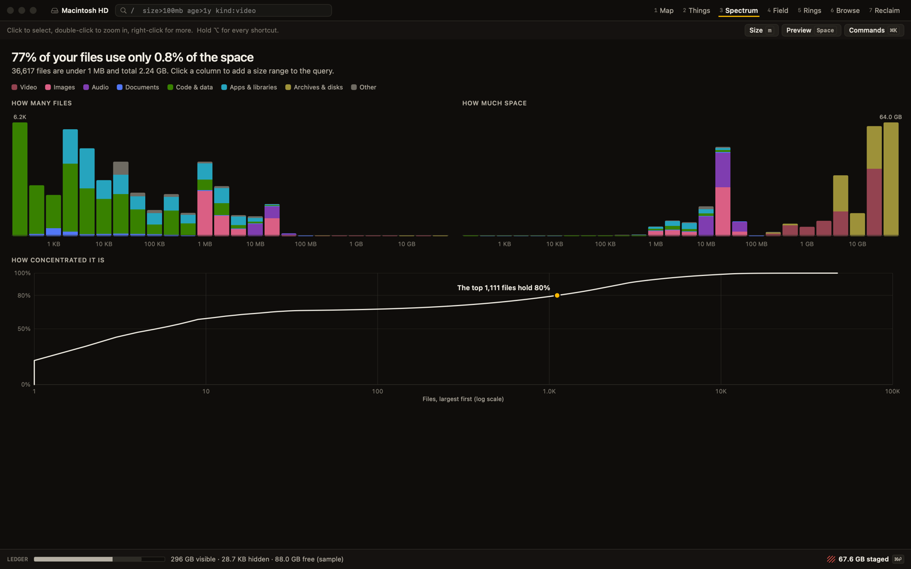

## Field

Field draws every file as a point of light, with age on one axis and size on the other, blended like a star field. The old and big corner is where the forgotten large things are. Brush a region to filter. The brush is written into the query, so we can see it and edit it.

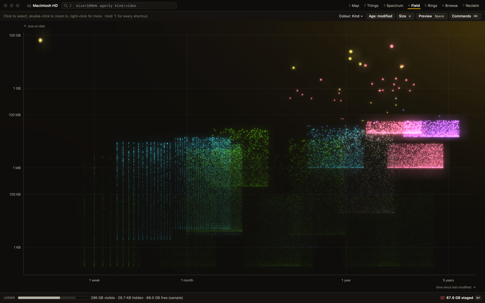

## Rings

Rings is a sunburst for hierarchy. It is quick to understand and good for structure. Arcs are harder to compare than rectangles, so we read exact sizes from the labels and the hover card.

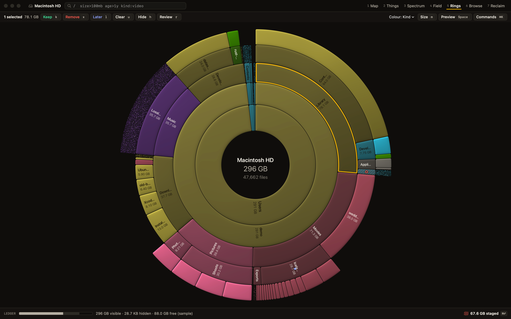

## Browse

Browse uses Miller columns, like Finder's column view, with an inline size bar on every row. It is fully keyboard-driven.

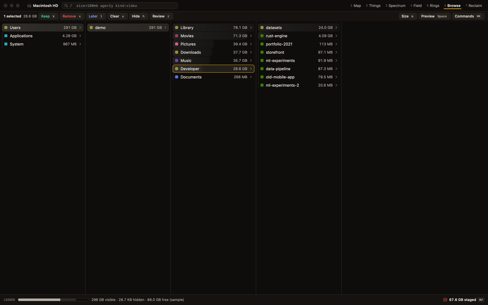

## Reclaim

Reclaim groups rule families by tier. Each row shows what the place is, what removing it costs, any condition ("close Xcode first"), how old it is, and the official cleanup command where one exists. One decision can cover hundreds of items, and duplicates are included. The [rule table](reclaim-rules.md) lists every built-in rule.

### Worklists

Many items have no tier, so there are four factual lists for them. The lists hide what you have already decided, and nothing in them is ever "never".

| Worklist | What is in it |
|---|---|
| Forgotten | Items of at least 100 MB whose newest change anywhere inside is over a year old. Files and folders are peers. |
| Duplicates | Exact duplicate files, with the wasted bytes |
| Leftovers | Folders in `~/Library` that belong to an app that is not installed. Where the owner is only a guess from a name, the list says so. |
| Largest undecided | The biggest things you have not marked |

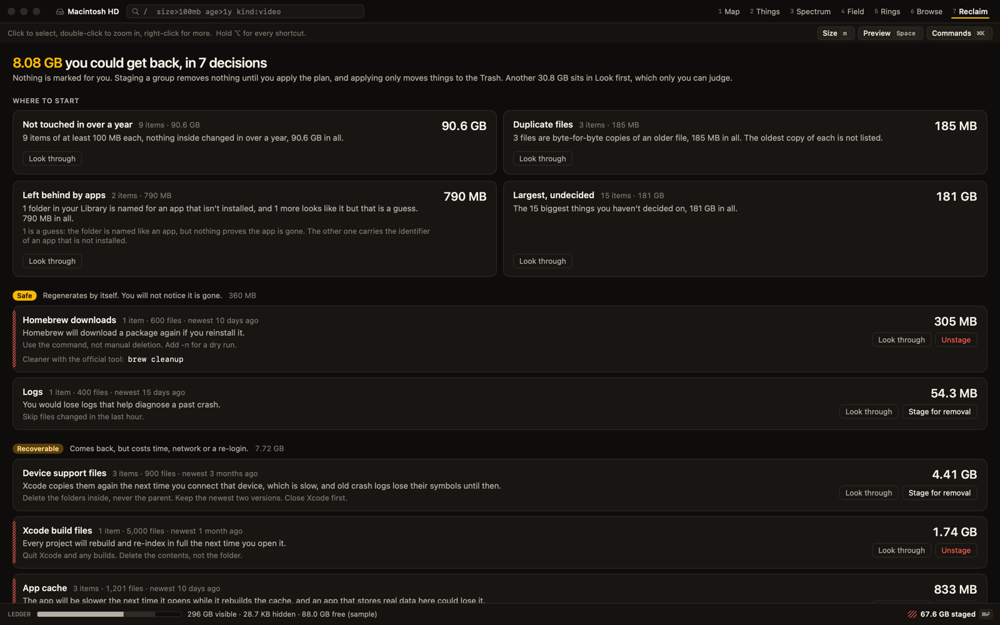

Leftovers never raise a tier. They stay "look first".

## Review

Press <kbd>r</kbd> to take the current set (a selection, a query result or a Reclaim family) full screen. We get a large preview, a filmstrip, and a counter like "38 left, 214 GB decided". With one folder selected, Review opens on what is inside it. The next item is preloaded, so moving along is instant.

| Key | In Review |
|---|---|
| <kbd>&larr;</kbd> <kbd>&rarr;</kbd> | Previous or next item in this level |
| <kbd>k</kbd> <kbd>x</kbd> <kbd>l</kbd> | Keep, mark for removal, or decide later. The mark stays on this item, and nothing moves on by itself |
| <kbd>u</kbd> | Clear this item's mark |
| <kbd>&#8984;Z</kbd> | Undo the last mark, wherever it was |
| <kbd>&#9166;</kbd> | Go into the folder on screen, starting at its first item |
| <kbd>Esc</kbd> | Go back up to the folder you came from. At the level Review opened on, close Review. Your marks stay |
| <kbd>&#8984;&#9166;</kbd> | Open the Plan |

A mark on a folder reaches everything inside it, and the deepest mark wins. So we can mark a folder for removal, go in, and keep one photo. A folder with marks inside it shows how many, such as "12 of 40 marked". Packages such as an `.app` stay one item. Items are sorted biggest first, by the current metric.

The item's path can be selected, and **Copy path** or <kbd>&#8984;C</kbd> copies all of it. Keep is the default, and nothing is pre-marked.

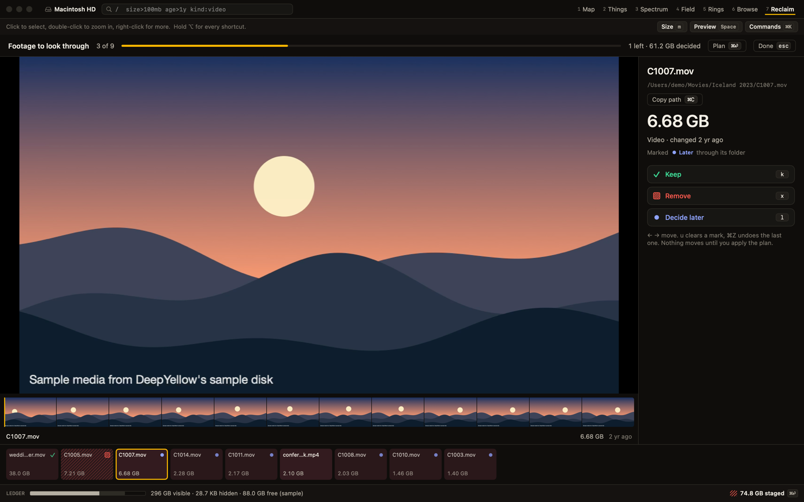

## Preview

<kbd>Space</kbd> opens a pane on the right from any view, and the arrow keys keep working underneath it. Video plays with a filmstrip and hover scrub, images decode to screen size with pan and zoom, audio shows a waveform, and PDFs and text render natively. Everything else uses QuickLook. A folder shows a composition of its largest children. A preview never downloads an iCloud placeholder. For those you get metadata and an explicit Download button.

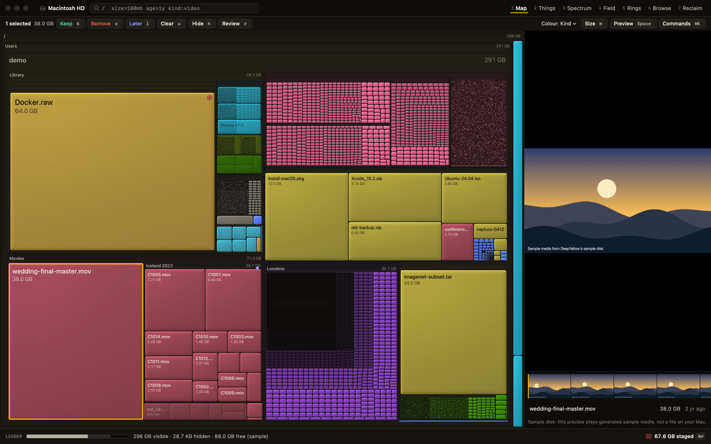

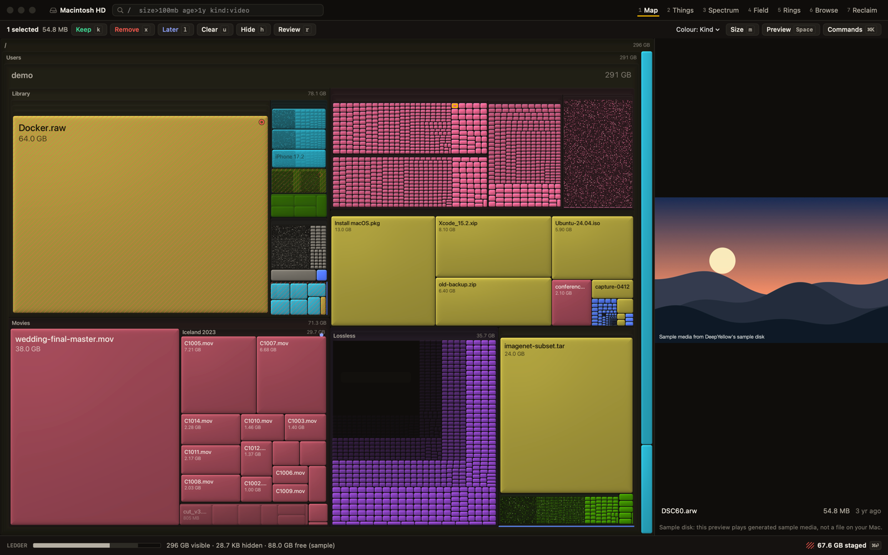

## SQL

<kbd>s</kbd> opens the SQL drawer at the bottom. It is not an eighth view, since the view above stays visible and responds to the result. A result with an `id` column, or a `GROUP BY` with `ids(id)`, becomes the set that Map, Things, Spectrum, Field and Rings show. Folders bring their whole subtree, and the result combines with the `/` query. A table without an `id` leaves the views alone. SQL is read-only. See [SQL](sql.md).

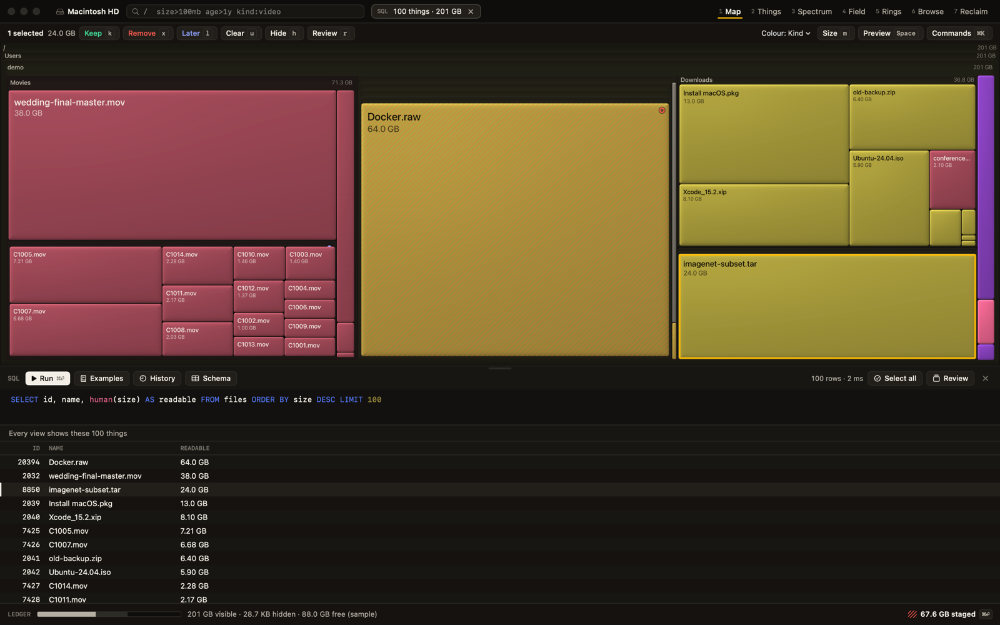

## Palette and query

<kbd>&#8984;K</kbd> opens the palette, which lists every command and also jumps to an exact path you type or paste. There is no fuzzy path search and no saved queries. <kbd>/</kbd> focuses the [query](query-language.md).

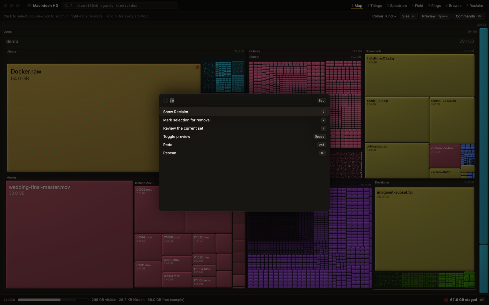

## Keyboard

| Key | Action | Key | Action |
|---|---|---|---|
| <kbd>1</kbd> to <kbd>7</kbd> | Switch view | <kbd>k</kbd> <kbd>x</kbd> <kbd>l</kbd> <kbd>u</kbd> | Keep, remove, later, clear |
| <kbd>Space</kbd> | Toggle preview | <kbd>r</kbd> | Review the current set |
| <kbd>&#9166;</kbd> / <kbd>&#9003;</kbd> | Go into the selected folder / zoom out | <kbd>&#8984;&#9166;</kbd> | Open the Plan |
| arrow keys | Move selection. Map: to the next tile in the level. Things: <kbd>&#8593;</kbd> <kbd>&#8595;</kbd> along the list | <kbd>&#8984;Z</kbd> / <kbd>&#8679;&#8984;Z</kbd> | Undo / redo |
| <kbd>&#8984;R</kbd> | Rescan, staying where you are | <kbd>&#8984;C</kbd> | In Review, copy the item's path |
| <kbd>/</kbd> | Focus the query | <kbd>h</kbd> | Hide the selection |
| <kbd>&#8984;K</kbd> | Palette | <kbd>m</kbd> / <kbd>c</kbd> | Metric / colour mode |
| <kbd>&#8997;</kbd> (hold) | Show all shortcuts | <kbd>Esc</kbd> | Back out one level. Map: select the folder above |
| <kbd>s</kbd> | Toggle the [SQL](sql.md) drawer | | |

## Hiding

Hide rules take things out of the views but never out of the accounting. macOS plumbing such as Spotlight indexes and system volume internals is hidden by default, while `~/Library/Caches` is deliberately kept visible. Right-click for "Hide this", "Hide all named X" or "Hide all .ext". Rules apply instantly with no rescan, and a toast offers Undo. The Ledger always shows how much is hidden and by which rule.
