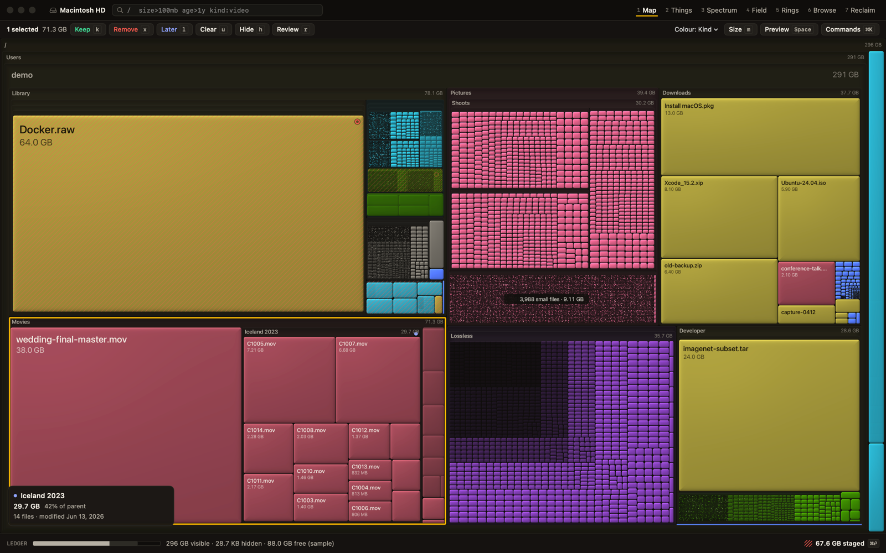
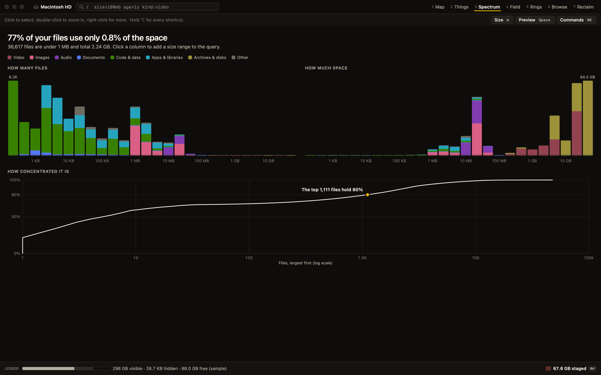
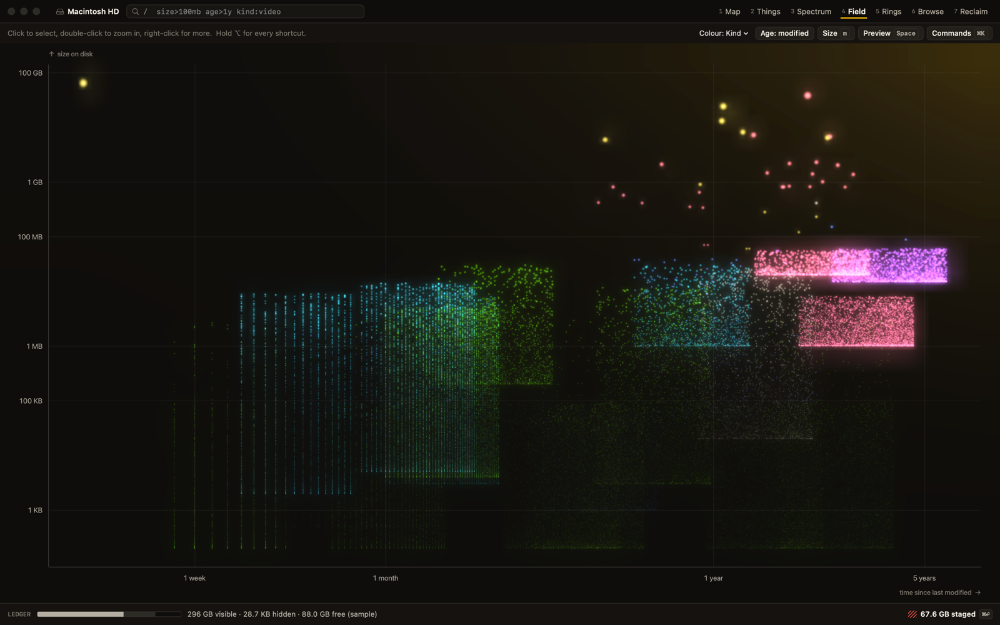
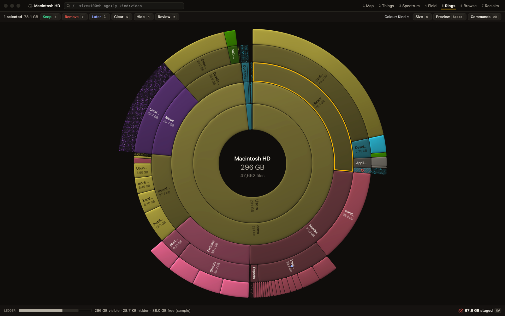
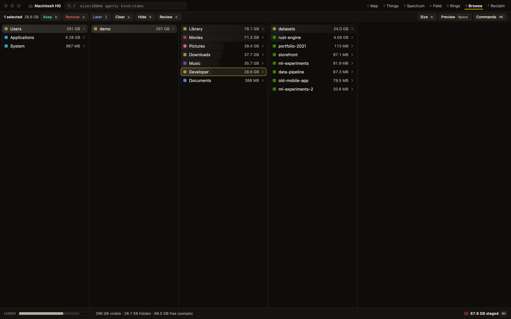
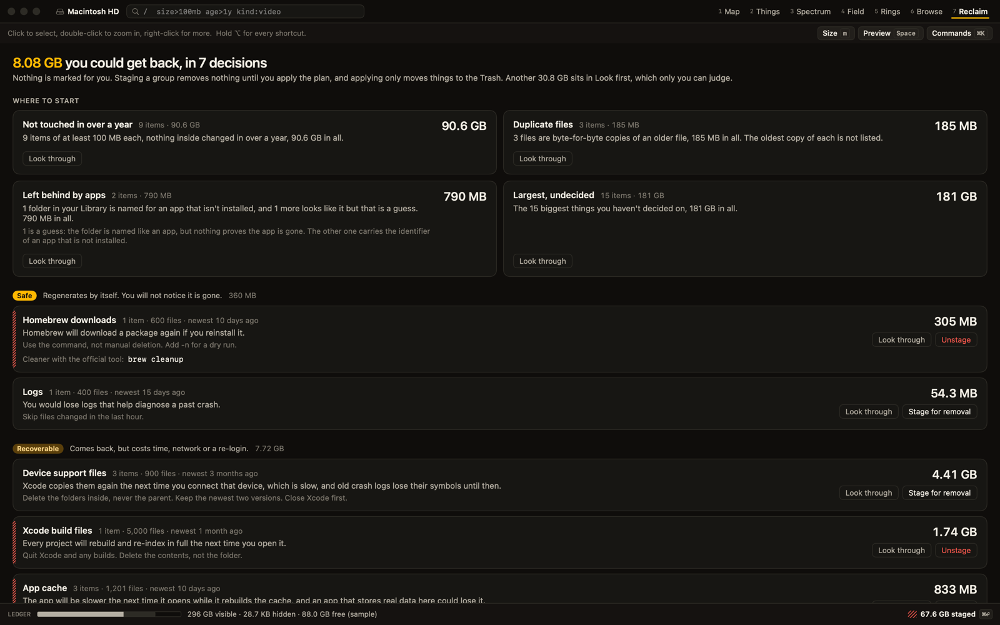
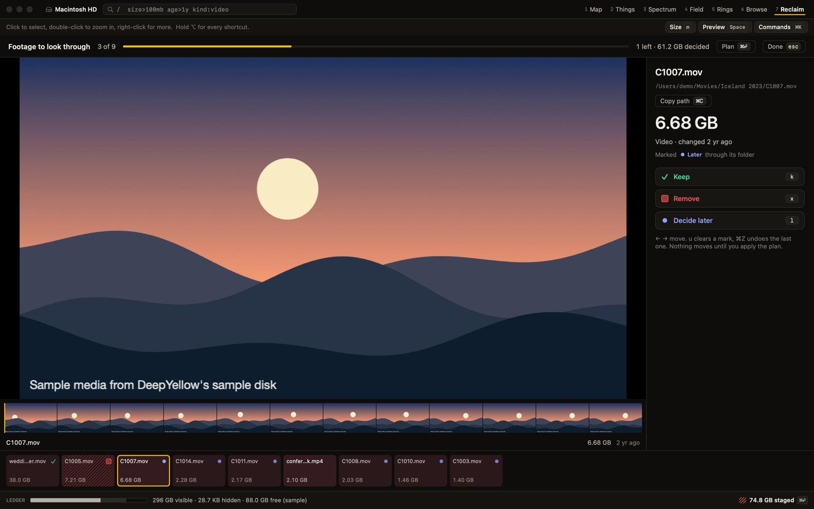
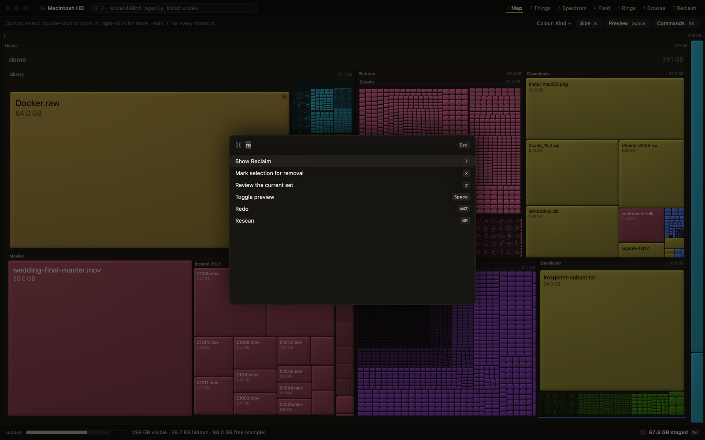

# Views

Seven lenses and one mode. All of them read the same scan, share one selection and one query, and are one key away. Switching keeps your focus and selection.

| Key | View | The question it answers |
|---|---|---|
| <kbd>1</kbd> | [Map](#map) | Where did it all go? |
| <kbd>2</kbd> | [Things](#things) | What are the biggest things? |
| <kbd>3</kbd> | [Spectrum](#spectrum) | What shape is my disk? |
| <kbd>4</kbd> | [Field](#field) | What is old, big and forgotten? |
| <kbd>5</kbd> | [Rings](#rings) | How is it nested? |
| <kbd>6</kbd> | [Browse](#browse) | Where is that thing I know about? |
| <kbd>7</kbd> | [Reclaim](#reclaim) | What can I remove safely? |
| <kbd>r</kbd> | [Review](#review) | Should this go? A mode, not a lens. |

The window is one thin line at the top (path, query, view tabs) and one at the bottom (the [Ledger](safety-and-accounting.md#the-ledger)). Panels appear only when you ask. Hold <kbd>&#8997;</kbd> to overlay every shortcut on the screen.

## Map

A treemap: each rectangle is a file or folder, sized by its bytes. It zooms continuously. Scroll or pinch to zoom around the cursor, drag to pan, double-click or <kbd>&#9166;</kbd> to zoom in, <kbd>&#9003;</kbd> to zoom out. Layout is fixed in world space, so zooming never reflows tiles.

- Folders large enough on screen get a header with name and size. Tiles get labels when they fit.
- **Dust.** Tiles too small to see merge into one stippled tile per folder, labelled like "3,988 small files, 9.11 GB". The stipple density follows the count. Zooming into dust keeps going and resolves into tiles at any depth.
- **Metric.** Press <kbd>m</kbd> to switch between bytes and file count. Swarms invisible by bytes become giants by count.

- **Hover** shows the name, size, share of the parent, last modified, file count, safety tier and why.

### Colour modes

Press <kbd>c</kbd> in Map, Rings or Field to cycle:

| Mode | Colours mean |
|---|---|
| Kind | Video, images, audio, documents, code and data, apps and libraries, archives and disks, other |
| Age | How long since the item changed |
| Safety | Gold where it is reclaimable, everything else dimmed |
| Decision | What you marked: remove is a hatch, keep is a pin, later is a dot |

State is never colour alone.

## Things

A ranked list of the biggest things, with files and folders as peers. A thing is a file or folder that is at least the threshold and cannot be split into anything that big. A folder with a big child is split, and the remainder is rolled into "N smaller items in X", or carried up if it is still under the threshold. The result never counts anything twice and adds up exactly to the total.

The slider sets the level of detail, from a dozen things to thousands. At a threshold of 400 MB, a 400 MB file and a 410 MB folder are neighbouring rows. A cumulative-share rail shows how much of the disk the top rows hold.

Some folders are treated as **atoms** and stay whole until you open them: apps and other packages, and folders named `node_modules`, `.git`, `DerivedData`, `.venv`, `venv`, `__pycache__`, `Pods`, `.gradle`, `.next`, `.cache` and `.pnpm-store`. `target`, `dist` and `build` count as atoms only when a project file such as `Cargo.toml` or `package.json` sits beside them.

## Spectrum

The size histogram of your files in human ranges, three bins per power of ten. Count and bytes are shown as two separate small multiples, never on one dual axis, plus a cumulative curve that answers questions like "the top 40 items hold 80% of your disk". Brush a range to filter every other view.

## Field

Every file as a point of light, with age on one axis and size on the other, blended like a star field. The old and big corner is where the forgotten large things are. Brush a region to filter; the brush is written into the query so you can see and edit it.

## Rings

A sunburst for hierarchy. It is quick to understand and good for structure; read exact sizes from labels and the hover card, because arcs are harder to compare than rectangles.

## Browse

Miller columns, like Finder's column view, with an inline size bar on every row. Fully keyboard-driven.

## Reclaim

Rule families grouped by tier. Each row shows what the place is, what removing it costs, any condition ("close Xcode first"), how old it is, and the official cleanup command where one exists. One decision can cover hundreds of items. Duplicates are included. The [rule table](reclaim-rules.md) lists every built-in rule.

### Worklists

Four factual lists for the many items that have no tier. They hide what you have already decided, and nothing in them is ever "never".

| Worklist | What is in it |
|---|---|
| Forgotten | Items of at least 100 MB whose newest change anywhere inside is over a year old. Files and folders are peers. |
| Duplicates | Exact duplicate files, with the wasted bytes |
| Leftovers | Folders in `~/Library` that belong to an app that is not installed. Where the owner is only a guess from a name, the list says so. |
| Largest undecided | The biggest things you have not marked |

Leftovers never raise a tier. They stay "look first".

## Review

Press <kbd>r</kbd> to take the current set (a selection, a query result or a Reclaim family) full screen: a large preview, a filmstrip, and a counter like "38 left, 214 GB decided". The next item is preloaded so advancing is instant. Keep is the default, and nothing is pre-marked.

## Preview

<kbd>Space</kbd> opens a pane on the right from any view, and the arrow keys keep working underneath it. Video plays with a filmstrip and hover scrub; images decode to screen size with pan and zoom; audio shows a waveform; PDFs and text render natively; everything else uses QuickLook. A folder shows a composition of its largest children. iCloud placeholders are never downloaded by a preview: you get metadata and an explicit Download button.

## SQL

<kbd>s</kbd> opens the SQL drawer at the bottom. It is not an eighth view: the view above stays visible and responds to the result. A result with an `id` column, or a `GROUP BY` with `ids(id)`, becomes the set that Map, Things, Spectrum, Field and Rings show. Folders bring their whole subtree, and the result combines with the `/` query. A table without an `id` leaves the views alone. Read-only. See [SQL](sql.md).

## Palette and query

<kbd>&#8984;K</kbd> opens the palette: every command, and a jump to an exact path you type or paste. There is no fuzzy path search and no saved queries. <kbd>/</kbd> focuses the [query](query-language.md).

## Keyboard

| Key | Action | Key | Action |
|---|---|---|---|
| <kbd>1</kbd> to <kbd>7</kbd> | Switch view | <kbd>k</kbd> <kbd>x</kbd> <kbd>l</kbd> <kbd>u</kbd> | Keep, remove, later, clear |
| <kbd>Space</kbd> | Toggle preview | <kbd>r</kbd> | Review the current set |
| <kbd>&#9166;</kbd> / <kbd>&#9003;</kbd> | Zoom in / out | <kbd>&#8984;&#9166;</kbd> | Open the Plan |
| arrow keys | Move selection | <kbd>&#8984;Z</kbd> / <kbd>&#8679;&#8984;Z</kbd> | Undo / redo |
| <kbd>/</kbd> | Focus the query | <kbd>h</kbd> | Hide the selection |
| <kbd>&#8984;K</kbd> | Palette | <kbd>m</kbd> / <kbd>c</kbd> | Metric / colour mode |
| <kbd>&#8997;</kbd> (hold) | Show all shortcuts | <kbd>Esc</kbd> | Back out one level |
| <kbd>s</kbd> | Toggle the [SQL](sql.md) drawer | | |

## Hiding

Hide rules take things out of the views, never out of the accounting. macOS plumbing such as Spotlight indexes and system volume internals is hidden by default, while `~/Library/Caches` is kept visible on purpose. Right-click for "Hide this", "Hide all named X" or "Hide all .ext". Rules apply instantly, with no rescan, and a toast offers Undo. The Ledger always shows how much is hidden and by which rule.
